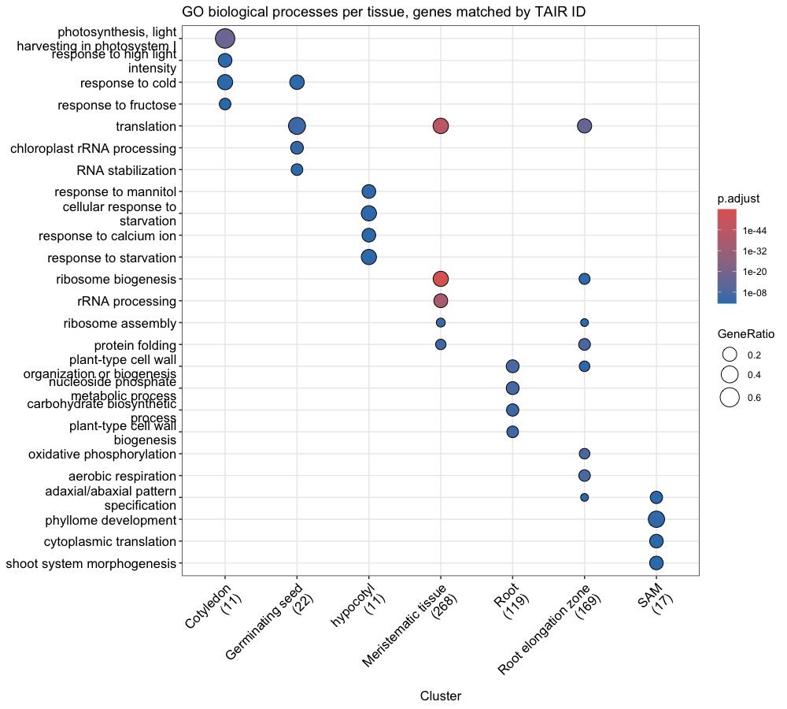
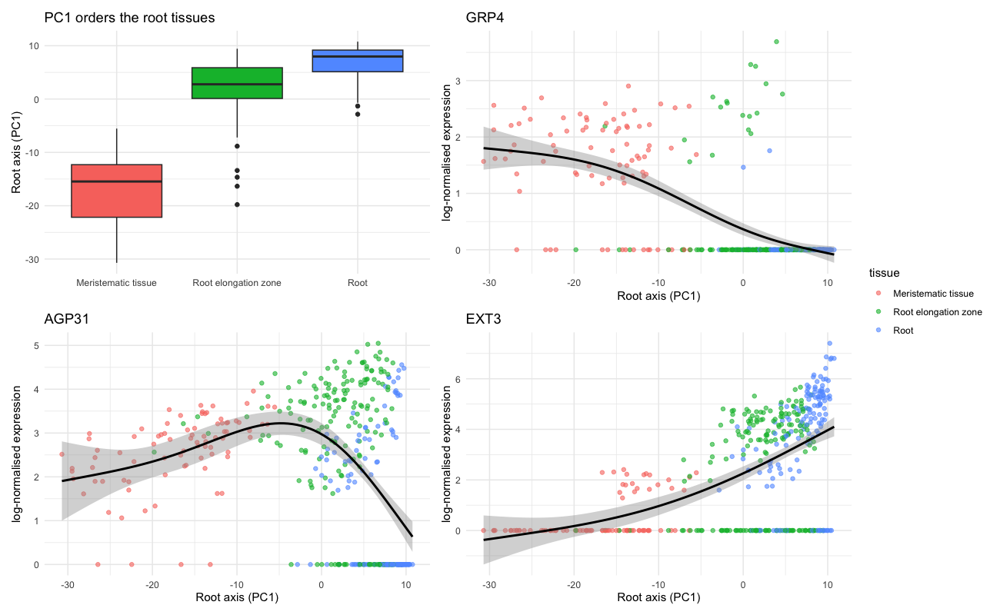

# Arabidopsis Visium HD: follow-up analyses

> **Spin-off of [DrSeed/arabidopsis-visium-hd](https://github.com/DrSeed/arabidopsis-visium-hd).**
> That project reproduced a published spatial transcriptomics analysis of *Arabidopsis* seedlings
> step by step. This project starts where it ended. It tries the four "next steps" it proposed,
> and asks how robust its results are.

```
ashrest58-commits/arabidopsis-visium-hd-spatial-transcriptomics    original published analysis
        │
        ▼
DrSeed/arabidopsis-visium-hd                                       step-by-step reproduction
        │
        ▼
DrSeed/arabidopsis-visium-hd-followup   ← this repository          four follow-up analyses
```

The git history shows the link: the first commit here is the original project's commit, and the
follow-up work is added on top of it.

> **Next in the series:** part 3,
> [arabidopsis-visium-hd-atlas](https://github.com/DrSeed/arabidopsis-visium-hd-atlas), checks the
> tissue labels against a published single-nucleus atlas.
> [arabidopsis-visium-hd-series](https://github.com/DrSeed/arabidopsis-visium-hd-series) compares
> all three parts.

**➡ Read the new analyses: [follow_up_analyses.md](follow_up_analyses.md)**
(source: [follow_up_analyses.Rmd](follow_up_analyses.Rmd))

## What the follow-up found

| Idea | Result |
|---|---|
| **16 µm bins instead of 8 µm** | About 2.5× more molecules per bin and much less dropout (the SAM marker is detected in 57% of SAM bins instead of 27%). But root and elongation zone merge, and the SAM shrinks to 7 bins. 8 µm suits this slide better. |
| **SCTransform normalisation** | Same number of clusters. The root tissues are unchanged, but the shoot tissue borders shift and the SAM merges with the hypocotyl. |
| **BANKSY spatial clustering** | Without spatial information it matches the original tissues (ARI 0.78). With it, clusters get smoother but follow the separate seedling pieces instead of tissue types. |
| **GO with TAIR IDs, GSEA on all genes** | 98% of genes usable instead of 42%. Hypocotyl gains GO terms. GSEA now finds ribosome, translation and plastid processes higher in germinating seed, which the original GSEA missed. |
| **Gradient along the root** | No piece of tissue holds the whole root axis. Within pieces, meristem genes give way to elongation-zone and root genes. An expression-based axis recovers meristem → elongation zone → root. |

**What ties them together:** the root tissues and the photosynthesis signal hold up under every
change tried. The borders between the shoot tissues (cotyledon, germinating seed, hypocotyl, SAM)
are the least stable part of the original analysis.





## What is carried over from the original project

- **[arabidopsis_analysis.md](arabidopsis_analysis.md)**, the annotated main notebook, is included
  so this repository runs on its own. It is the same as in the original project with one fix:
  very small p-values in its tables now show their real value (for example `1e-22`) instead of
  being rounded to `0`.

## How to run

1. Open `arabidopsis-visium-hd-followup.Rproj` in RStudio.
2. In `arabidopsis_analysis.Rmd`, run the Step 1 (packages) and Step 2 (768 MB data download)
   chunks once, then press **Knit**. This saves `results/annotated.rds`.
3. In `follow_up_analyses.Rmd`, run the install chunk once, then press **Knit**.

Each notebook takes about one minute. The raw data are not stored in this repository.

## Files

| File | Contents |
|---|---|
| `follow_up_analyses.Rmd` / `.md` + `follow_up_analyses_files/` | **New:** the four follow-up analyses, with figures |
| `arabidopsis_analysis.Rmd` / `.md` + `arabidopsis_analysis_files/` | Carried over: the main reproduction notebook |
| `results/DE_cot_vs_germ.csv` | Differential expression table from the main notebook |
| `arabidopsis-visium-hd-followup.Rproj` | RStudio project file |

## Credits

- **Original analysis:** Anita Shrestha,
  [ashrest58-commits/arabidopsis-visium-hd-spatial-transcriptomics](https://github.com/ashrest58-commits/arabidopsis-visium-hd-spatial-transcriptomics)
  (MIT licence).
- **Data:** 10x Genomics public dataset *Visium HD 3′ Arabidopsis* (Space Ranger 4.0.1 outputs).
- **Methods:** Seurat (including SCTransform), BANKSY, clusterProfiler, org.At.tair.db, mgcv.
  Exact versions are at the end of each notebook.
