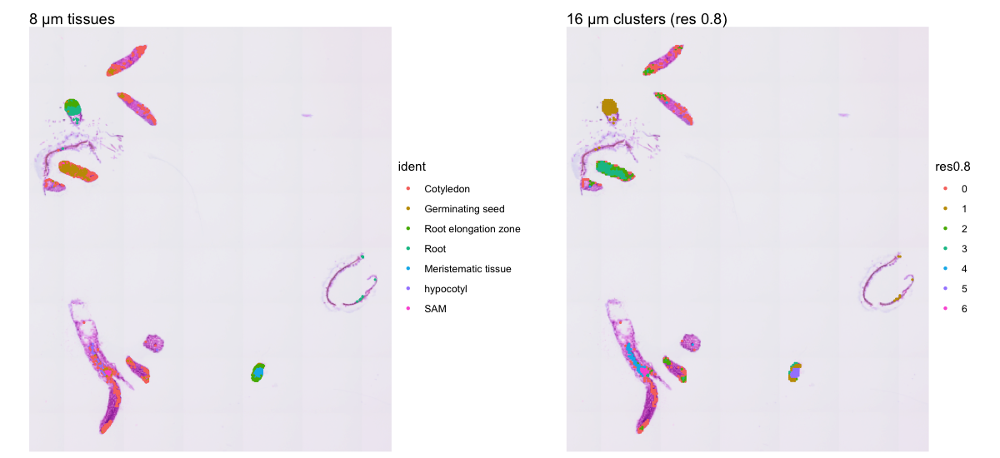
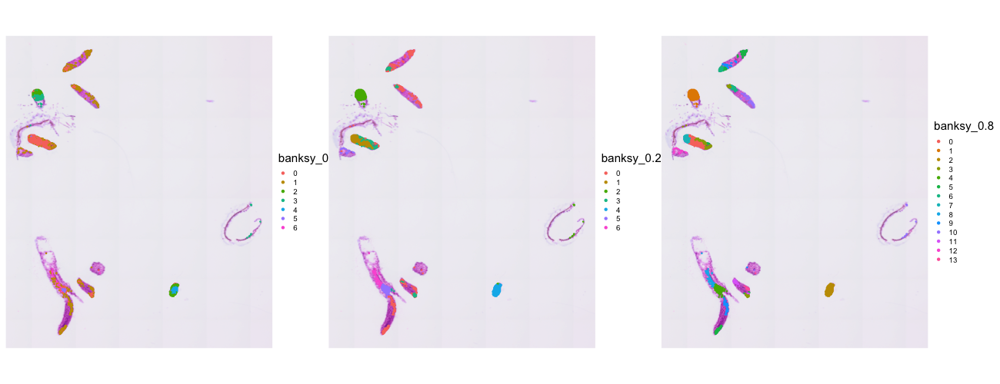
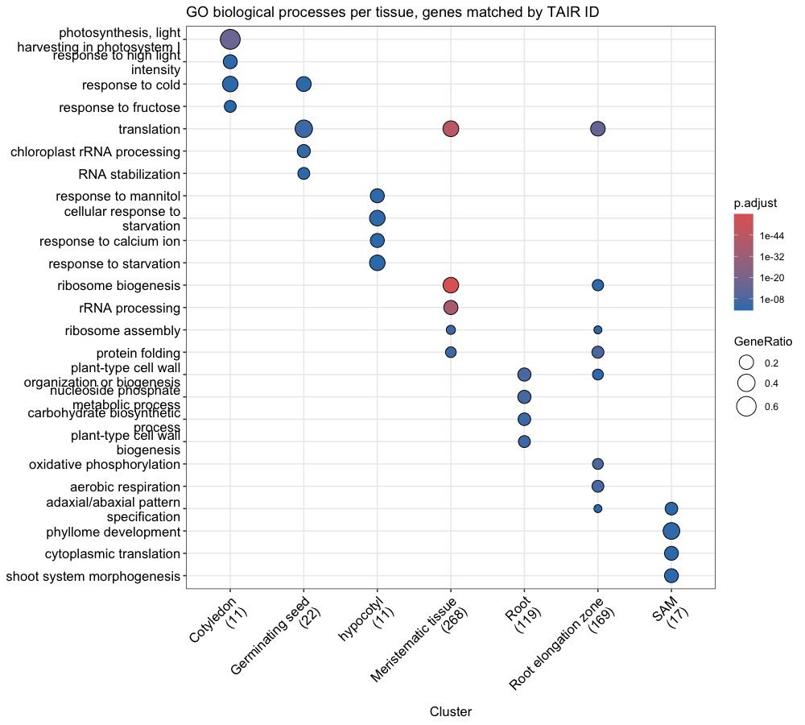
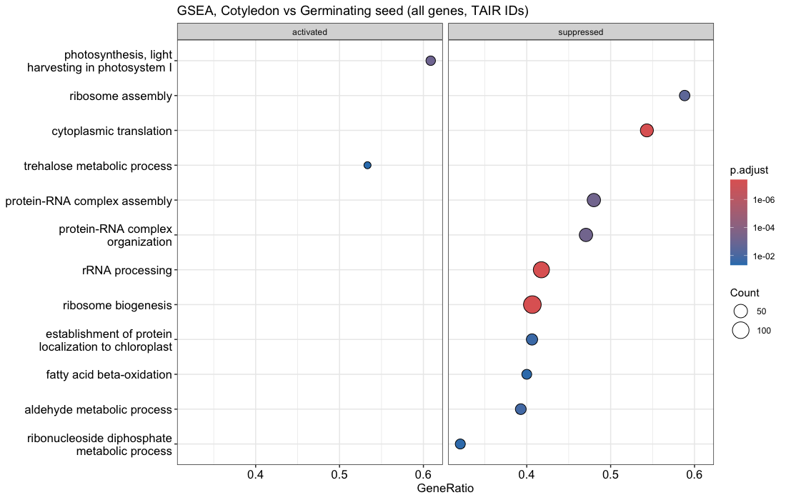
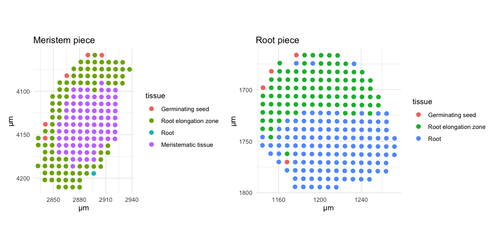
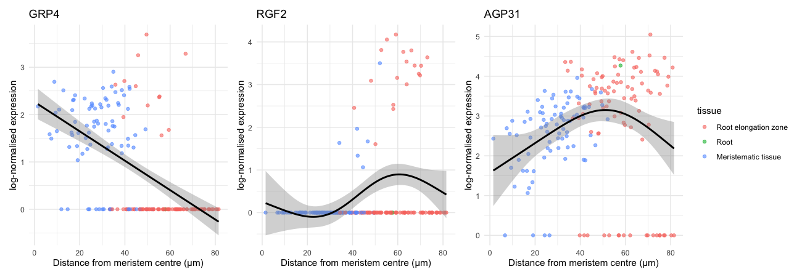
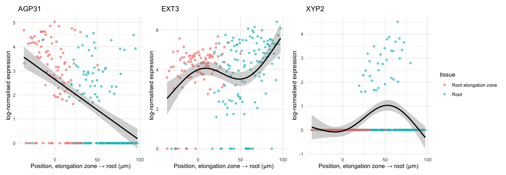
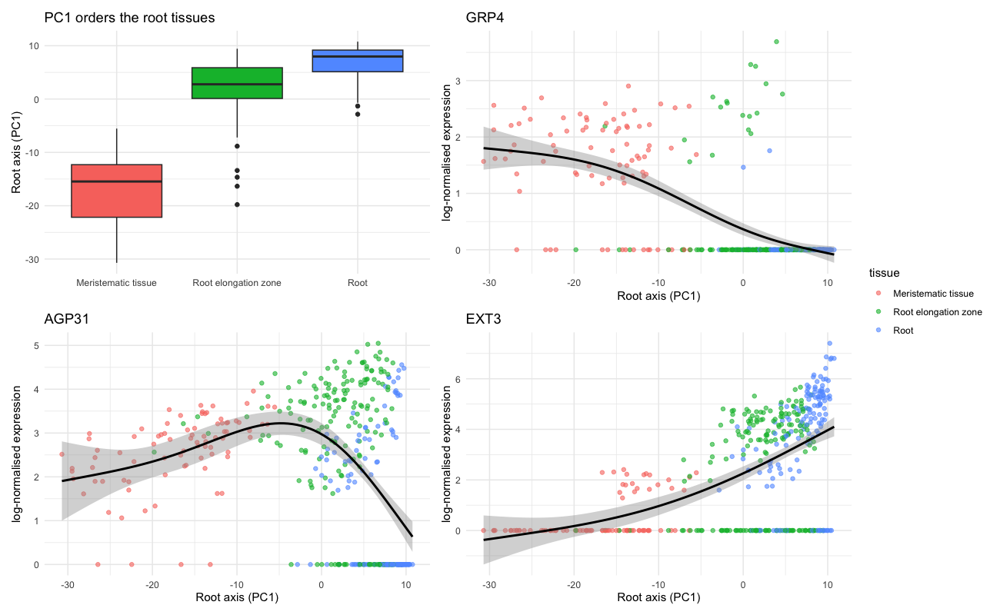

Follow-up analyses: bin size, normalisation, spatial clustering, GO and
root gradients
================
Dr. Seed
November 2026

- [About this notebook](#about-this-notebook)
- [Setup: shared objects and two
  scores](#setup-shared-objects-and-two-scores)
- [Part 1: 16 µm bins instead of 8
  µm](#part-1-16-µm-bins-instead-of-8-µm)
  - [A fair comparison: the same tissue
    footprint](#a-fair-comparison-the-same-tissue-footprint)
  - [Is there less noise?](#is-there-less-noise)
  - [Are the same tissues found?](#are-the-same-tissues-found)
- [Part 2: SCTransform and BANKSY](#part-2-sctransform-and-banksy)
  - [2a. SCTransform instead of
    LogNormalize](#2a-sctransform-instead-of-lognormalize)
  - [2b. BANKSY: clustering that also uses
    position](#2b-banksy-clustering-that-also-uses-position)
- [Part 3: GO enrichment with TAIR IDs, and GSEA on all
  genes](#part-3-go-enrichment-with-tair-ids-and-gsea-on-all-genes)
  - [3a. Matching genes by TAIR locus
    ID](#3a-matching-genes-by-tair-locus-id)
  - [3b. GSEA on all genes](#3b-gsea-on-all-genes)
- [Part 4: A gradient along the root](#part-4-a-gradient-along-the-root)
  - [Where are the root tissues?](#where-are-the-root-tissues)
  - [4a. Meristem piece: distance from the meristem
    centre](#4a-meristem-piece-distance-from-the-meristem-centre)
  - [4b. Root piece: from elongation zone to
    root](#4b-root-piece-from-elongation-zone-to-root)
  - [4c. The full axis, reconstructed from
    expression](#4c-the-full-axis-reconstructed-from-expression)
- [Summary](#summary)
- [Session information](#session-information)

# About this notebook

This is the new part of a spin-off project. The original project,
[DrSeed/arabidopsis-visium-hd](https://github.com/DrSeed/arabidopsis-visium-hd),
reproduced a published Visium HD analysis step by step. Its [main
notebook](arabidopsis_analysis.md) is carried over into this repository,
so this one runs on its own.

That main notebook ends with four ideas for next steps. This notebook
tries all four:

1.  **Bin size.** Repeat the analysis with 16 µm bins. Are the same
    tissues found, with less noise?
2.  **Normalisation and spatial clustering.** Does `SCTransform()`
    change the clusters? What happens with **BANKSY**, a clustering
    method that also uses each bin’s neighbours?
3.  **GO analysis.** Match genes by TAIR locus ID instead of gene
    symbol, and run GSEA on *all* genes instead of a pre-filtered list.
4.  **Root gradient.** Follow expression along the root (meristematic
    tissue → elongation zone → root) instead of away from the shoot
    meristem.

Each part follows the same pattern: the question, why it matters, what I
did, the result, and an honest conclusion. A summary of all four answers
is at the end.

**Before running:** knit the main notebook first. This one starts from
the annotated object it saves (`results/annotated.rds`) and uses the
same `data/` folder. The extra packages are installed once with the
chunk below.

``` r
options(timeout = 3600)
BiocManager::install(c("Banksy", "SpatialExperiment", "glmGamPoi"), update = FALSE, ask = FALSE)
install.packages(c("aricode", "igraph"))
```

- **Banksy** and **SpatialExperiment**: the BANKSY method and the data
  container it works on.
- **glmGamPoi**: makes `SCTransform()` much faster.
- **aricode**: computes the Adjusted Rand Index (explained below).
- **igraph**: finds the separate tissue pieces.

# Setup: shared objects and two scores

``` r
library(Seurat); library(dplyr); library(ggplot2); library(patchwork)

obj    <- readRDS("results/annotated.rds")   # 8 µm bins, named tissues (main notebook)
tissue <- Idents(obj)
um_per_px <- jsonlite::fromJSON(
  "data/binned_outputs/square_008um/spatial/scalefactors_json.json")$microns_per_pixel

coords <- GetTissueCoordinates(obj)
rownames(coords) <- coords$cell
coords <- coords[colnames(obj), c("x", "y")]
```

To compare two ways of grouping the same bins, I use two scores.

- **Adjusted Rand Index (ARI)** measures how well two groupings agree. 1
  means identical, and 0 means no better than chance. Cluster *numbers*
  don’t matter, only which bins end up together.
- **Spatial coherence** is, on average, the share of a bin’s 8 nearest
  neighbours on the slide that are in the same cluster as the bin
  itself. A high value means the clusters form smooth patches. A low
  value means they are speckled.

``` r
ari <- function(a, b) aricode::ARI(as.integer(factor(a)), as.integer(factor(b)))

dist_px <- as.matrix(dist(coords)); diag(dist_px) <- Inf
nearest8 <- t(apply(dist_px, 1, function(r) order(r)[1:8]))
coherence <- function(labels) {
  labels <- as.character(labels)
  mean(sapply(seq_along(labels), function(i) mean(labels[nearest8[i, ]] == labels[i])))
}
```

**Tissue pieces.** The slide holds many separate pieces of seedling.
Here, two bins belong to the same piece if a chain of bins connects
them, with each step shorter than 3 bin widths (24 µm). This needs no
guess about the number of pieces, unlike the k-means used in the main
notebook.

``` r
linked <- dist_px < 3 * 8 / um_per_px                   # 3 bin widths, in pixels
coords$piece <- igraph::components(
  igraph::graph_from_adjacency_matrix(linked, mode = "undirected"))$membership
```

The tissues from the main notebook score 0.75 on spatial coherence. This
is the baseline for the comparisons below.

------------------------------------------------------------------------

# Part 1: 16 µm bins instead of 8 µm

**Question:** 16 µm bins pool the RNA of four 8 µm bins. Do we find the
same tissues, with less noise?

**Why it matters:** choosing a bin size is a trade-off. Small bins keep
fine detail but capture few molecules each, so many genes read as zero
by chance (“dropout”). Large bins capture more molecules but blur the
borders between tissues.

## A fair comparison: the same tissue footprint

``` r
obj16 <- Load10X_Spatial("data", bin.size = 16)
c(bins_under_tissue = ncol(obj16),
  pass_same_QC_as_8um = sum(obj16$nCount_Spatial.016um > 100 & obj16$nFeature_Spatial.016um > 50))
```

    ##   bins_under_tissue pass_same_QC_as_8um 
    ##                2089                1279

Reusing the 8 µm quality filter (more than 100 UMIs and 50 genes) is not
fair here. A 16 µm bin covers four times the area, so many bins that
only touch the edge of the tissue pass it. Those bins would add a lot of
extra area that was excluded at 8 µm.

So I keep exactly the **same footprint**: the 16 µm bins that contain at
least one of the 1,516 8 µm bins that passed quality control. Then any
difference comes from the bin size alone.

The barcodes make this easy. `s_008um_00456_00333-1` is the 8 µm bin in
row 456, column 333 of the 8 µm grid. Each 16 µm bin is a 2 × 2 block of
8 µm bins, so its row and column are the 8 µm ones divided by 2 (rounded
down).

``` r
rowcol <- do.call(rbind, strsplit(sub("s_008um_(\\d+)_(\\d+)-1", "\\1 \\2", colnames(obj)), " "))
parent <- sprintf("s_016um_%05d_%05d-1",
                  as.integer(rowcol[, 1]) %/% 2, as.integer(rowcol[, 2]) %/% 2)
names(parent) <- colnames(obj)

obj16 <- subset(obj16, cells = unique(parent))
obj16 <- obj16[rowSums(LayerData(obj16, layer = "counts")) > 0, ]
dim(obj16)
```

    ## [1] 18067   565

``` r
# Label each 16 µm bin with the tissue of most of its 8 µm bins, for comparison only
majority <- tapply(as.character(tissue), parent, function(v) names(which.max(table(v))))
obj16$tissue8 <- as.character(majority[colnames(obj16)])
```

## Is there less noise?

``` r
data.frame(bin_size = c("8 µm", "16 µm"),
           bins = c(ncol(obj), ncol(obj16)),
           median_UMIs_per_bin = c(median(obj$nCount_Spatial.008um), median(obj16$nCount_Spatial.016um)),
           median_genes_per_bin = c(median(obj$nFeature_Spatial.008um), median(obj16$nFeature_Spatial.016um))) %>%
  knitr::kable()
```

| bin_size | bins | median_UMIs_per_bin | median_genes_per_bin |
|:---------|-----:|--------------------:|---------------------:|
| 8 µm     | 1516 |                 222 |                  193 |
| 16 µm    |  565 |                 556 |                  446 |

``` r
key <- c("Cotyledon" = "CAB1", "Germinating seed" = "ICL", "Root elongation zone" = "EXPA9",
         "Root" = "EXT3", "Meristematic tissue" = "GRP4", "hypocotyl" = "XYP2", "SAM" = "CYP78A5")
detected <- function(o, labels, t) mean(FetchData(o, key[[t]])[labels == t, 1] > 0)
data.frame(tissue = names(key), marker = unname(key),
           bins_8um  = sapply(names(key), function(t) sum(tissue == t)),
           detected_8um  = sapply(names(key), function(t) sprintf("%.0f%%", 100 * detected(obj, tissue, t))),
           bins_16um = sapply(names(key), function(t) sum(obj16$tissue8 == t)),
           detected_16um = sapply(names(key), function(t) sprintf("%.0f%%", 100 * detected(obj16, obj16$tissue8, t)))) %>%
  knitr::kable(row.names = FALSE, caption = "Share of each tissue's bins in which its marker gene is detected")
```

| tissue               | marker  | bins_8um | detected_8um | bins_16um | detected_16um |
|:---------------------|:--------|---------:|:-------------|----------:|:--------------|
| Cotyledon            | CAB1    |      567 | 62%          |       293 | 83%           |
| Germinating seed     | ICL     |      440 | 60%          |       118 | 79%           |
| Root elongation zone | EXPA9   |      183 | 51%          |        51 | 80%           |
| Root                 | EXT3    |      145 | 82%          |        54 | 83%           |
| Meristematic tissue  | GRP4    |       83 | 80%          |        23 | 100%          |
| hypocotyl            | XYP2    |       57 | 11%          |        19 | 32%           |
| SAM                  | CYP78A5 |       41 | 27%          |         7 | 57%           |

Share of each tissue’s bins in which its marker gene is detected

**Yes, much less dropout.** Each 16 µm bin captures more than twice as
many molecules, and every marker gene is detected in a larger share of
its tissue’s bins. The SAM marker CYP78A5 goes from about a quarter of
SAM bins to more than half.

## Are the same tissues found?

The 16 µm bins are clustered with exactly the settings of the main
notebook, at resolution 0.5 and also at 0.8.

``` r
obj16 <- NormalizeData(obj16, verbose = FALSE) |>
  FindVariableFeatures(nfeatures = 3000, verbose = FALSE) |>
  ScaleData(verbose = FALSE) |>
  RunPCA(npcs = 50, verbose = FALSE) |>
  FindNeighbors(dims = 1:15, verbose = FALSE)
obj16 <- FindClusters(obj16, resolution = 0.5, verbose = FALSE); obj16$res0.5 <- Idents(obj16)
obj16 <- FindClusters(obj16, resolution = 0.8, verbose = FALSE); obj16$res0.8 <- Idents(obj16)

c(clusters_res0.5 = nlevels(obj16$res0.5), ARI_res0.5 = round(ari(obj16$res0.5, obj16$tissue8), 2),
  clusters_res0.8 = nlevels(obj16$res0.8), ARI_res0.8 = round(ari(obj16$res0.8, obj16$tissue8), 2))
```

    ## clusters_res0.5      ARI_res0.5 clusters_res0.8      ARI_res0.8 
    ##            5.00            0.46            7.00            0.49

``` r
short <- c("Cotyledon" = "Cot", "Germinating seed" = "Germ", "Root elongation zone" = "REZ",
           "Root" = "Root", "Meristematic tissue" = "Meri", "hypocotyl" = "Hyp", "SAM" = "SAM")
table(cluster_16um = obj16$res0.8,
      tissue_8um = factor(short[obj16$tissue8], levels = short)) %>%
  as.data.frame.matrix() %>% knitr::kable(caption = "16 µm clusters (resolution 0.8) vs the 8 µm tissue of each bin")
```

|     | Cot | Germ | REZ | Root | Meri | Hyp | SAM |
|:----|----:|-----:|----:|-----:|-----:|----:|----:|
| 0   | 186 |    2 |   0 |    0 |    0 |   4 |   0 |
| 1   |   1 |    1 |  44 |   53 |    0 |   0 |   0 |
| 2   |  77 |   19 |   0 |    1 |    0 |   1 |   0 |
| 3   |   5 |   81 |   3 |    0 |    0 |   0 |   0 |
| 4   |  23 |    5 |   0 |    0 |    0 |  14 |   0 |
| 5   |   0 |    0 |   4 |    0 |   23 |   0 |   0 |
| 6   |   1 |   10 |   0 |    0 |    0 |   0 |   7 |

16 µm clusters (resolution 0.8) vs the 8 µm tissue of each bin

``` r
SpatialDimPlot(obj, pt.size.factor = 6) + ggtitle("8 µm tissues") |
  SpatialDimPlot(obj16, group.by = "res0.8", pt.size.factor = 3) + ggtitle("16 µm clusters (res 0.8)")
```

<!-- -->

**Conclusion, Part 1:** 16 µm bins are less noisy, but they find **fewer
distinct tissues**.

- At the same settings (resolution 0.5) they give 5 clusters instead of
  7.
- Even at resolution 0.8, root and root elongation zone stay merged in
  one cluster.
- The SAM shrinks to only 7 bins, which cluster together with some
  germinating-seed bins.
- Agreement with the 8 µm tissues is moderate (ARI ≈ 0.5).

For finding tissues in these small seedlings, 8 µm bins are the better
choice. 16 µm bins would suit questions about single genes, where
dropout matters more than sharp borders.

------------------------------------------------------------------------

# Part 2: SCTransform and BANKSY

## 2a. SCTransform instead of LogNormalize

**Question:** does the normalisation method change the tissues we find?

**Why it matters:** `NormalizeData()` (LogNormalize) divides each gene
by the bin’s total count and takes the log. It assumes one scaling
factor suits every gene. `SCTransform()` instead fits a statistical
model to each gene (a regularised negative binomial). That model
accounts for how a gene’s variability depends on the bin’s total count,
and it uses the leftover differences (Pearson residuals) for clustering.
It is often better at removing sequencing-depth effects.

``` r
sct <- SCTransform(obj, assay = "Spatial.008um", verbose = FALSE)   # uses glmGamPoi if installed
sct <- RunPCA(sct, npcs = 50, verbose = FALSE) |>
  FindNeighbors(dims = 1:15, verbose = FALSE) |>
  FindClusters(resolution = 0.5, verbose = FALSE)
obj$sct_cluster <- Idents(sct)

c(clusters = nlevels(obj$sct_cluster), ARI_vs_LogNormalize = round(ari(obj$sct_cluster, tissue), 2),
  coherence = round(coherence(obj$sct_cluster), 2))
```

    ##            clusters ARI_vs_LogNormalize           coherence 
    ##                7.00                0.38                0.79

``` r
table(SCT_cluster = obj$sct_cluster, tissue = factor(short[as.character(tissue)], levels = short)) %>%
  as.data.frame.matrix() %>% knitr::kable(caption = "SCTransform clusters vs the main notebook's tissues")
```

|     | Cot | Germ | REZ | Root | Meri | Hyp | SAM |
|:----|----:|-----:|----:|-----:|-----:|----:|----:|
| 0   | 299 |   61 |   0 |    0 |    0 |   0 |   0 |
| 1   | 178 |   95 |   0 |    0 |    0 |   3 |   2 |
| 2   |  27 |  230 |   0 |    0 |    0 |   0 |   3 |
| 3   |  63 |   46 |   6 |   10 |    0 |  54 |  36 |
| 4   |   0 |    7 | 143 |   16 |    2 |   0 |   0 |
| 5   |   0 |    1 |   2 |  119 |    0 |   0 |   0 |
| 6   |   0 |    0 |  32 |    0 |   81 |   0 |   0 |

SCTransform clusters vs the main notebook’s tissues

**Conclusion, 2a:** SCTransform also gives 7 clusters, but the overlap
with the original tissues is only partial (ARI 0.38).

- **The root tissues are robust.** Elongation zone, root and
  meristematic tissue come out largely the same with either method.
- **The shoot tissues are not.** Cotyledon and germinating seed are
  divided along different lines, and the SAM merges with the hypocotyl.

The borders between the shoot tissues therefore depend on analysis
choices and should be treated with caution. The root tissues are a
firmer result.

## 2b. BANKSY: clustering that also uses position

**Question:** if clustering also looks at each bin’s neighbours, do we
get cleaner tissues?

**How BANKSY works:** for every bin, BANKSY adds two things to its own
expression:

- the average expression of its spatial neighbours;
- a “gradient” term that captures how expression changes across the
  neighbourhood.

The weight **λ (lambda)** sets how much the neighbours count.

- **λ = 0:** expression only, with no spatial information.
- **λ ≈ 0.2:** “cell-typing mode”, a little spatial smoothing.
- **λ ≈ 0.8:** “domain mode”, where the neighbourhood dominates and the
  method looks for spatial domains.

To isolate the effect of the spatial information, I take BANKSY’s PCA
for each λ and cluster it with **exactly the same settings** as the main
notebook (15 dimensions, resolution 0.5). Only λ changes.

``` r
se <- SpatialExperiment::SpatialExperiment(
  assays = list(logcounts = as.matrix(LayerData(obj, layer = "data")[VariableFeatures(obj), ])),
  spatialCoords = as.matrix(coords[, c("x", "y")]))
se <- Banksy::computeBanksy(se, assay_name = "logcounts", compute_agf = TRUE,
                            k_geom = c(15, 30), verbose = FALSE)
lambdas <- c(0, 0.2, 0.8)
se <- Banksy::runBanksyPCA(se, use_agf = TRUE, lambda = lambdas, npcs = 20, seed = 1000)

banksy_summary <- data.frame(lambda = "main notebook", clusters = 7, ARI_vs_tissues = 1,
                             coherence = round(coherence(tissue), 2))
for (l in lambdas) {
  # put BANKSY's PCA for this lambda into the Seurat object, then cluster it as usual
  emb <- SingleCellExperiment::reducedDim(se, paste0("PCA_M1_lam", l))
  key_name <- paste0("BANKSY", gsub("\\.", "", l), "_")
  rownames(emb) <- colnames(obj)
  colnames(emb) <- paste0(key_name, seq_len(ncol(emb)))
  obj[["banksy"]] <- CreateDimReducObject(embeddings = emb, key = key_name, assay = "Spatial.008um")
  tmp <- FindNeighbors(obj, reduction = "banksy", dims = 1:15, verbose = FALSE) |>
    FindClusters(resolution = 0.5, verbose = FALSE)
  obj[[paste0("banksy_", l)]] <- Idents(tmp)
  banksy_summary <- rbind(banksy_summary, data.frame(
    lambda = l, clusters = nlevels(Idents(tmp)), ARI_vs_tissues = round(ari(Idents(tmp), tissue), 2),
    coherence = round(coherence(Idents(tmp)), 2)))
}
knitr::kable(banksy_summary)
```

| lambda        | clusters | ARI_vs_tissues | coherence |
|:--------------|---------:|---------------:|----------:|
| main notebook |        7 |           1.00 |      0.75 |
| 0             |        7 |           0.78 |      0.74 |
| 0.2           |        7 |           0.46 |      0.90 |
| 0.8           |       14 |           0.22 |      0.95 |

As λ rises, the clusters become much smoother (coherence goes up), but
they agree *less* with the tissues. To see why, look at where the root
elongation zone bins go at λ = 0.2:

``` r
rez <- tissue == "Root elongation zone"
table(BANKSY_cluster_lambda0.2 = obj$banksy_0.2[rez], tissue_piece = coords$piece[rez]) %>%
  as.data.frame.matrix() %>% filter(rowSums(.) > 0) %>%
  knitr::kable(caption = "Root elongation zone bins: BANKSY cluster (rows) vs tissue piece (columns)")
```

|     |   3 |   5 |
|:----|----:|----:|
| 2   |   2 |  93 |
| 4   |  88 |   0 |

Root elongation zone bins: BANKSY cluster (rows) vs tissue piece
(columns)

``` r
SpatialDimPlot(obj, group.by = c("banksy_0", "banksy_0.2", "banksy_0.8"), pt.size.factor = 6, ncol = 3) &
  theme(legend.key.size = unit(0.3, "cm"), legend.text = element_text(size = 7))
```

<!-- -->

**Conclusion, 2b:**

- **With λ = 0,** BANKSY’s clusters closely match the main notebook’s
  tissues (ARI ≈ 0.8). The method itself is not the difference.
- **With spatial information switched on,** the elongation zone is no
  longer one cluster. Its bins split by the **tissue piece** they sit
  in: they join the root in one piece and the meristem in the other.
- **At λ = 0.8,** the cotyledon breaks into small clusters, roughly one
  per piece.

BANKSY is doing what it is designed to do: find spatially continuous
**domains**. On this slide, though, the domains are mostly the separate
pieces of seedling, not tissue types shared across pieces. BANKSY would
be the better tool for one large, continuous section of tissue. For this
slide, expression-only clustering answers the question “which tissue is
this bin?” better.

------------------------------------------------------------------------

# Part 3: GO enrichment with TAIR IDs, and GSEA on all genes

## 3a. Matching genes by TAIR locus ID

**Question:** how many genes did the main notebook lose by matching on
gene symbols, and does keeping them change the results?

**Why:** the GO database `org.At.tair.db` is organised around TAIR locus
IDs (such as AT1G01010). Many genes have no gene symbol in it, so
matching by symbol silently drops them. 10x stores the TAIR ID of every
gene in `features.tsv.gz`. Seurat changed some names when loading (`_`
became `-`, and duplicated names got `.1`), so the same changes are
applied here to match them up.

``` r
library(clusterProfiler); library(org.At.tair.db); library(enrichplot)

features <- read.delim(gzfile("data/binned_outputs/square_008um/filtered_feature_bc_matrix/features.tsv.gz"),
                       header = FALSE, col.names = c("tair", "symbol", "type"))
symbol_to_tair <- setNames(features$tair, gsub("_", "-", make.unique(features$symbol)))
stopifnot(all(rownames(obj) %in% names(symbol_to_tair)))   # every gene has a TAIR ID
universe_tair <- unname(symbol_to_tair[rownames(obj)])

n_go_symbol <- length(unique(suppressWarnings(bitr(rownames(obj), "SYMBOL", "GO", org.At.tair.db))$SYMBOL))
n_go_tair   <- length(unique(suppressWarnings(bitr(universe_tair, "TAIR", "GO", org.At.tair.db))$TAIR))
data.frame(matched_by = c("gene symbol (main notebook)", "TAIR locus ID"),
           genes_with_GO_terms = c(n_go_symbol, n_go_tair),
           share_of_detected_genes = sprintf("%.0f%%", 100 * c(n_go_symbol, n_go_tair) / nrow(obj))) %>%
  knitr::kable()
```

| matched_by                  | genes_with_GO_terms | share_of_detected_genes |
|:----------------------------|--------------------:|:------------------------|
| gene symbol (main notebook) |                7519 | 42%                     |
| TAIR locus ID               |               17519 | 98%                     |

The same ORA as in the main notebook (the same marker lists and
cut-offs), run both ways:

``` r
markers <- FindAllMarkers(obj, only.pos = TRUE, verbose = FALSE)
markers$tissue <- as.character(markers$cluster)
sel <- markers %>% filter(p_val_adj < 0.05) %>%
  filter(case_when(tissue == "Meristematic tissue" ~ avg_log2FC > 1.5 & pct.1 > 0.40,
                   tissue == "hypocotyl"           ~ avg_log2FC > 0.5 & pct.1 > 0.10,
                   TRUE                            ~ avg_log2FC > 1.0 & pct.1 > 0.25))

run_ora <- function(genes, key_type, universe) {
  res <- compareCluster(split(genes, sel$tissue), fun = "enrichGO", OrgDb = org.At.tair.db,
                        keyType = key_type, ont = "BP", universe = universe,
                        pvalueCutoff = 0.05, qvalueCutoff = 0.05)
  simplify(res, cutoff = 0.7)
}
ora_symbol <- run_ora(sel$gene, "SYMBOL", rownames(obj))
ora_tair   <- run_ora(unname(symbol_to_tair[sel$gene]), "TAIR", universe_tair)

count_terms <- function(res) table(factor(as.data.frame(res)$Cluster, levels = names(short)))
data.frame(tissue = names(short),
           GO_terms_by_symbol = as.vector(count_terms(ora_symbol)),
           GO_terms_by_TAIR   = as.vector(count_terms(ora_tair))) %>%
  knitr::kable(caption = "Significant GO terms per tissue after simplifying")
```

| tissue               | GO_terms_by_symbol | GO_terms_by_TAIR |
|:---------------------|-------------------:|-----------------:|
| Cotyledon            |                  2 |                5 |
| Germinating seed     |                  1 |                6 |
| Root elongation zone |                 16 |               34 |
| Root                 |                 36 |               47 |
| Meristematic tissue  |                  9 |               17 |
| hypocotyl            |                  0 |                7 |
| SAM                  |                  2 |                7 |

Significant GO terms per tissue after simplifying

``` r
dotplot(ora_tair, showCategory = 4) +
  theme(axis.text.x = element_text(angle = 45, hjust = 1)) +
  ggtitle("GO biological processes per tissue, genes matched by TAIR ID")
```

<!-- -->

**Conclusion, 3a:** matching by TAIR ID keeps almost every detected gene
instead of fewer than half.

- Every tissue gets more significant GO terms.
- **Hypocotyl now has significant terms**, where it had none before.
  They are about starvation and stress responses, the same themes as in
  the original analysis. That earlier “no terms” result was partly a
  matter of lost genes.
- **The SAM gains leaf-patterning terms:** “adaxial/abaxial pattern
  specification” and “shoot system morphogenesis”, processes expected
  around a shoot meristem.
- The main findings stay the same: photosynthesis (cotyledon), ribosome
  biogenesis and translation (meristem), cell wall (root), phyllome
  development (SAM).

## 3b. GSEA on all genes

**Question:** the main notebook’s GSEA found only “activated” terms
(higher in cotyledon), even though 49 genes were significantly higher in
germinating seed. Is that because it saw only 331 pre-filtered genes?

**What changes:**

- **All genes are tested:** `FindMarkers` runs with
  `logfc.threshold = 0` and `min.pct = 0`.
- **IDs are TAIR:** genes are matched by TAIR ID.
- **The ranking is different:** genes are ranked by a *signed
  significance score*, `sign(log2FC) × −log10(p)`. Once all genes are
  included, many are detected in only a handful of bins, and their fold
  changes are large but unreliable. The signed score puts genes that are
  *consistently* higher in one tissue at the ends of the ranking.

``` r
de_all <- FindMarkers(obj, ident.1 = "Cotyledon", ident.2 = "Germinating seed",
                      logfc.threshold = 0, min.pct = 0, verbose = FALSE)
de_all$tair  <- symbol_to_tair[rownames(de_all)]
de_all$score <- sign(de_all$avg_log2FC) * -log10(pmax(de_all$p_val, 1e-300))

run_gsea <- function(values) {
  ranked <- sort(setNames(values, de_all$tair), decreasing = TRUE)
  set.seed(123)
  res <- gseGO(ranked, OrgDb = org.At.tair.db, keyType = "TAIR", ont = "BP", minGSSize = 10,
               maxGSSize = 500, pvalueCutoff = 0.05, seed = TRUE, verbose = FALSE)
  simplify(res, cutoff = 0.7)
}
gsea_score <- run_gsea(de_all$score)
gsea_fc    <- run_gsea(de_all$avg_log2FC)

summarise_gsea <- function(res) { d <- as.data.frame(res); c(terms = nrow(d), higher_in_cotyledon = sum(d$NES > 0), higher_in_germinating_seed = sum(d$NES < 0)) }
rbind(`main notebook (331 genes, fold change, symbols)` = c(6, 6, 0),
      `all genes, fold change, TAIR` = summarise_gsea(gsea_fc),
      `all genes, signed score, TAIR` = summarise_gsea(gsea_score)) %>% knitr::kable()
```

|  | terms | higher_in_cotyledon | higher_in_germinating_seed |
|:---|---:|---:|---:|
| main notebook (331 genes, fold change, symbols) | 6 | 6 | 0 |
| all genes, fold change, TAIR | 10 | 2 | 8 |
| all genes, signed score, TAIR | 21 | 2 | 19 |

``` r
as.data.frame(gsea_score) %>% arrange(p.adjust) %>% head(15) %>%
  transmute(Description, setSize, NES = round(NES, 2),
            p.adjust = formatC(p.adjust, format = "g", digits = 2),
            higher_in = ifelse(NES > 0, "Cotyledon", "Germinating seed")) %>%
  knitr::kable(row.names = FALSE)
```

| Description | setSize | NES | p.adjust | higher_in |
|:---|---:|---:|:---|:---|
| cytoplasmic translation | 81 | -1.84 | 3.9e-08 | Germinating seed |
| ribosome biogenesis | 300 | -1.64 | 3.9e-08 | Germinating seed |
| rRNA processing | 218 | -1.58 | 3.9e-08 | Germinating seed |
| plastid organization | 293 | -1.46 | 6.1e-07 | Germinating seed |
| monocarboxylic acid metabolic process | 398 | -1.33 | 0.00025 | Germinating seed |
| protein-RNA complex organization | 102 | -1.55 | 0.00068 | Germinating seed |
| protein-RNA complex assembly | 100 | -1.54 | 0.00068 | Germinating seed |
| embryo development ending in seed dormancy | 493 | -1.30 | 0.00068 | Germinating seed |
| photosynthesis, light harvesting in photosystem I | 23 | 2.51 | 0.00087 | Cotyledon |
| protein folding | 153 | -1.47 | 0.0012 | Germinating seed |
| ribosome assembly | 34 | -1.72 | 0.0028 | Germinating seed |
| aerobic respiration | 153 | -1.40 | 0.013 | Germinating seed |
| response to heat | 261 | -1.31 | 0.013 | Germinating seed |
| protein maturation | 259 | -1.31 | 0.013 | Germinating seed |
| aldehyde metabolic process | 56 | -1.56 | 0.015 | Germinating seed |

``` r
dotplot(gsea_score, split = ".sign", showCategory = 10) + facet_grid(. ~ .sign) +
  ggtitle("GSEA, Cotyledon vs Germinating seed (all genes, TAIR IDs)")
```

<!-- -->

**Conclusion, 3b:** with all genes and TAIR IDs, GSEA finds both
directions.

- **Higher in germinating seed:** cytoplasmic translation, ribosome
  biogenesis, rRNA processing and plastid organisation. This matches the
  differential expression result in the main notebook, where the genes
  up in germinating seed were ribosomal and chloroplast-building genes.
  The earlier, smaller GSEA missed all of this.
- **Higher in cotyledon:** photosynthesis (light harvesting), as before.
- **The ranking choice matters:** ranked by fold change alone, the
  strongest terms are about the cell cycle instead. Different reasonable
  choices give different answers, so it is good practice to state the
  ranking you used.

------------------------------------------------------------------------

# Part 4: A gradient along the root

**Question:** can we follow expression along the root, from meristematic
tissue through the elongation zone to the root, the way the main
notebook followed it away from the SAM?

## Where are the root tissues?

``` r
root_tissues <- c("Meristematic tissue", "Root elongation zone", "Root")
table(piece = coords$piece[tissue %in% root_tissues],
      tissue = droplevels(tissue[tissue %in% root_tissues])) %>%
  as.data.frame.matrix() %>% filter(rowSums(.) > 10) %>% knitr::kable()
```

|     | Root elongation zone | Root | Meristematic tissue |
|:----|---------------------:|-----:|--------------------:|
| 3   |                   90 |    1 |                  83 |
| 5   |                   93 |  128 |                   0 |

The root tissues sit in **two pieces**, and **no piece contains all
three**:

- the “meristem piece” holds meristematic tissue and elongation zone;
- the “root piece” holds elongation zone and root.

``` r
root_df <- cbind(coords, tissue = tissue,
                 FetchData(obj, c("GRP4", "RGF2", "PLT1", "AGP31", "EXPA9", "EXT3", "XYP2")))
meristem_piece <- as.integer(names(which.max(table(coords$piece[tissue == "Meristematic tissue"]))))
root_piece     <- as.integer(names(which.max(table(coords$piece[tissue == "Root"]))))

piece_plot <- function(p, title) {
  ggplot(subset(root_df, piece == p), aes(x * um_per_px, y * um_per_px, colour = tissue)) +
    geom_point(size = 2.5) + coord_fixed() + scale_y_reverse() + theme_minimal() +
    labs(title = title, x = "µm", y = "µm")
}
piece_plot(meristem_piece, "Meristem piece") | piece_plot(root_piece, "Root piece")
```

<!-- -->

The two pieces are arranged differently:

- **Meristem piece:** the meristematic tissue is in the **centre**,
  surrounded by a ring of elongation zone. We don’t know exactly at what
  angle the section cut through it, so I measure distance from the
  meristem centre (a radial distance).
- **Root piece:** the elongation zone forms one half and the root the
  other. I measure each bin’s position along the line from the
  elongation-zone centre to the root centre.

Each gene gets a GAM fit, as in the main notebook. “Trend” says whether
expression rises or falls along the distance. Genes detected in fewer
than 5 bins of a piece are skipped.

``` r
fit_trends <- function(df, x, genes) {
  do.call(rbind, lapply(genes, function(g) {
    if (sum(df[[g]] > 0) < 5) return(NULL)
    s <- summary(mgcv::gam(as.formula(paste0("`", g, "` ~ s(", x, ", k = 4)")), data = df))
    data.frame(gene = g, bins_detected = sum(df[[g]] > 0),
               trend = ifelse(cor(df[[x]], df[[g]], method = "spearman") > 0, "rises", "falls"),
               p_value = format.pval(s$s.table[1, "p-value"], digits = 2),
               deviance_explained = paste0(round(100 * s$dev.expl, 1), "%"))
  }))
}
trend_plot <- function(df, x, g, xlab) {
  ggplot(df, aes(.data[[x]], .data[[g]])) + geom_point(aes(colour = tissue), alpha = 0.6) +
    geom_smooth(method = "gam", formula = y ~ s(x, k = 4), colour = "black") +
    labs(title = g, x = xlab, y = "log-normalised expression") + theme_minimal()
}
root_genes <- c("GRP4", "RGF2", "PLT1", "AGP31", "EXPA9", "EXT3", "XYP2")
```

## 4a. Meristem piece: distance from the meristem centre

``` r
mp <- subset(root_df, piece == meristem_piece & tissue %in% root_tissues)
centre <- colMeans(mp[mp$tissue == "Meristematic tissue", c("x", "y")])
mp$dist_um <- sqrt((mp$x - centre[1])^2 + (mp$y - centre[2])^2) * um_per_px

knitr::kable(fit_trends(mp, "dist_um", root_genes), row.names = FALSE)
```

| gene  | bins_detected | trend | p_value | deviance_explained |
|:------|--------------:|:------|:--------|:-------------------|
| GRP4  |            78 | falls | \<2e-16 | 31.3%              |
| RGF2  |            24 | rises | 2.4e-05 | 13.7%              |
| PLT1  |            34 | falls | 0.057   | 4.6%               |
| AGP31 |           151 | rises | 0.003   | 8.9%               |
| EXPA9 |            99 | rises | 0.088   | 4.2%               |
| EXT3  |            45 | rises | 2e-04   | 7.7%               |

``` r
(trend_plot(mp, "dist_um", "GRP4", "Distance from meristem centre (µm)") |
   trend_plot(mp, "dist_um", "RGF2", "Distance from meristem centre (µm)") |
   trend_plot(mp, "dist_um", "AGP31", "Distance from meristem centre (µm)")) +
  plot_layout(guides = "collect")
```

<!-- -->

## 4b. Root piece: from elongation zone to root

``` r
rp <- subset(root_df, piece == root_piece & tissue %in% root_tissues)
from <- colMeans(rp[rp$tissue == "Root elongation zone", c("x", "y")])
to   <- colMeans(rp[rp$tissue == "Root", c("x", "y")])
direction <- (to - from) / sqrt(sum((to - from)^2))
rp$position_um <- ((rp$x - from[1]) * direction[1] + (rp$y - from[2]) * direction[2]) * um_per_px

knitr::kable(fit_trends(rp, "position_um", root_genes), row.names = FALSE)
```

| gene  | bins_detected | trend | p_value | deviance_explained |
|:------|--------------:|:------|:--------|:-------------------|
| GRP4  |             8 | falls | 0.028   | 2.2%               |
| AGP31 |           124 | falls | \<2e-16 | 26.2%              |
| EXPA9 |            95 | falls | 0.36    | 1.9%               |
| EXT3  |           198 | rises | 1.1e-05 | 11.6%              |
| XYP2  |            34 | rises | \<2e-16 | 17.1%              |

``` r
(trend_plot(rp, "position_um", "AGP31", "Position, elongation zone → root (µm)") |
   trend_plot(rp, "position_um", "EXT3", "Position, elongation zone → root (µm)") |
   trend_plot(rp, "position_um", "XYP2", "Position, elongation zone → root (µm)")) +
  plot_layout(guides = "collect")
```

<!-- -->

## 4c. The full axis, reconstructed from expression

No piece shows the whole axis, but the three root tissues can still be
put in order by their *expression*. This is the idea behind “pseudotime”
methods. I re-run PCA on the root bins only and check whether the first
principal component (PC1) orders the bins meristem → elongation zone →
root.

``` r
root_obj <- subset(obj, idents = root_tissues)
root_obj <- FindVariableFeatures(root_obj, nfeatures = 2000, verbose = FALSE) |>
  ScaleData(verbose = FALSE) |> RunPCA(npcs = 20, verbose = FALSE)

axis_df <- cbind(data.frame(pc1 = Embeddings(root_obj, "pca")[, 1], tissue = droplevels(Idents(root_obj))),
                 FetchData(root_obj, root_genes))
# PCA signs are arbitrary: orient the axis so that it runs from meristem to root
if (mean(axis_df$pc1[axis_df$tissue == "Meristematic tissue"]) > mean(axis_df$pc1[axis_df$tissue == "Root"]))
  axis_df$pc1 <- -axis_df$pc1
axis_df %>% group_by(tissue) %>% summarise(bins = n(), mean_axis_position = round(mean(pc1), 1)) %>%
  arrange(mean_axis_position) %>% knitr::kable()
```

| tissue               | bins | mean_axis_position |
|:---------------------|-----:|-------------------:|
| Meristematic tissue  |   83 |              -17.0 |
| Root elongation zone |  183 |                2.3 |
| Root                 |  145 |                7.0 |

``` r
axis_df$tissue <- factor(axis_df$tissue, levels = root_tissues)
p_box <- ggplot(axis_df, aes(tissue, pc1, fill = tissue)) + geom_boxplot(show.legend = FALSE) +
  labs(x = NULL, y = "Root axis (PC1)", title = "PC1 orders the root tissues") + theme_minimal()
(p_box | trend_plot(axis_df, "pc1", "GRP4", "Root axis (PC1)")) /
  (trend_plot(axis_df, "pc1", "AGP31", "Root axis (PC1)") | trend_plot(axis_df, "pc1", "EXT3", "Root axis (PC1)")) +
  plot_layout(guides = "collect")
```

<!-- -->

``` r
knitr::kable(fit_trends(axis_df, "pc1", root_genes), row.names = FALSE)
```

| gene  | bins_detected | trend | p_value | deviance_explained |
|:------|--------------:|:------|:--------|:-------------------|
| GRP4  |            86 | falls | \<2e-16 | 42.8%              |
| RGF2  |            24 | falls | 0.0014  | 3.9%               |
| PLT1  |            35 | falls | \<2e-16 | 35.6%              |
| AGP31 |           275 | falls | \<2e-16 | 20.1%              |
| EXPA9 |           194 | falls | 0.036   | 2.3%               |
| EXT3  |           250 | rises | \<2e-16 | 31.8%              |
| XYP2  |            35 | falls | 0.00015 | 5.2%               |

**Conclusion, Part 4:**

- **On the slide,** no single piece shows the whole root axis. Within
  each piece the expected genes still change with position:
  - In the meristem piece, the meristem marker GRP4 falls with distance
    from the meristem centre, while the elongation-zone genes AGP31 and
    EXT3 rise towards the outer ring.
  - One result was unexpected: **RGF2**, a root meristem growth factor,
    is *not* highest in the centre. It is expressed in the outer ring,
    in bins labelled as elongation zone. Either the ring contains cells
    that make RGF2 (such as root-cap cells), or the labels in this piece
    are imperfect. This dataset cannot tell which.
  - In the root piece, AGP31 falls while EXT3 and XYP2 rise going from
    the elongation zone into the root.
- **In expression space,** the first principal component of the root
  bins puts the three tissues in the expected developmental order:
  meristematic tissue → elongation zone → root.
  - Along this axis, GRP4 falls steadily, AGP31 peaks in the elongation
    zone, and EXT3 rises towards the root end.
  - XYP2 is detected almost only in root bins at the very end of the
    axis, but in so few bins (35) that its smooth curve stays flat.

This expression-based axis is a reconstruction. It shows the *order* of
the tissues, not real distances in µm. A spatial gradient along a whole
root would need a section that cuts along the full length of one root.

------------------------------------------------------------------------

# Summary

| Idea | Answer |
|----|----|
| **16 µm bins** | Less noise: about 2.5× more molecules per bin, and markers detected in many more bins. But tissues are less well separated: root and elongation zone merge, and the SAM is barely resolved. 8 µm is better for finding tissues here. |
| **SCTransform** | Same number of clusters. The root tissues are unchanged, but the shoot tissue borders shift and the SAM merges with the hypocotyl. The root tissues are robust; the shoot borders depend on analysis choices. |
| **BANKSY** | Without spatial information it matches the main result (ARI ≈ 0.8). With it, clusters become smoother but follow the separate tissue pieces rather than tissue types. That suits continuous tissue, not a slide of many small pieces. |
| **TAIR IDs + GSEA on all genes** | 98% of genes usable instead of 42%. Hypocotyl gains GO terms. GSEA now also finds the ribosome, translation and plastid processes higher in germinating seed, consistent with the differential expression. |
| **Root gradient** | No piece contains the whole axis. Within pieces, GRP4 falls with distance from the meristem centre (RGF2 unexpectedly rises), and elongation-zone and root genes trade places along the elongation zone → root direction. In expression space, the full meristem → elongation zone → root order is recovered. |

**The lesson running through all four:** the main notebook’s findings
about the root tissues and about photosynthesis in the cotyledon are
robust to every change tried here. The borders between the shoot tissues
(cotyledon, germinating seed, hypocotyl, SAM) are the least stable part
of the analysis.

# Session information

``` r
sessionInfo()
```

    ## R version 4.6.1 (2026-06-24)
    ## Platform: aarch64-apple-darwin23
    ## Running under: macOS Golden Gate 27.2
    ## 
    ## Matrix products: default
    ## BLAS:   /Library/Frameworks/R.framework/Versions/4.6/Resources/lib/libRblas.0.dylib 
    ## LAPACK: /Library/Frameworks/R.framework/Versions/4.6/Resources/lib/libRlapack.dylib;  LAPACK version 3.12.1
    ## 
    ## locale:
    ## [1] en_GB/en_GB/en_GB/C/en_GB/en_GB
    ## 
    ## time zone: Africa/Lagos
    ## tzcode source: internal
    ## 
    ## attached base packages:
    ## [1] stats4    stats     graphics  grDevices utils     datasets  methods  
    ## [8] base     
    ## 
    ## other attached packages:
    ##  [1] enrichplot_1.32.1      org.At.tair.db_3.22.0  AnnotationDbi_1.74.0  
    ##  [4] IRanges_2.46.0         S4Vectors_0.50.3       Biobase_2.72.0        
    ##  [7] BiocGenerics_0.58.1    generics_0.1.4         clusterProfiler_4.20.3
    ## [10] future_1.80.0          patchwork_1.3.2        ggplot2_4.0.3         
    ## [13] dplyr_1.2.1            Seurat_5.6.0           SeuratObject_5.4.0    
    ## [16] sp_2.2-4              
    ## 
    ## loaded via a namespace (and not attached):
    ##   [1] fs_2.1.0                    matrixStats_1.5.0          
    ##   [3] spatstat.sparse_3.2-0       httr_1.4.9                 
    ##   [5] RColorBrewer_1.1-3          tools_4.6.1                
    ##   [7] sctransform_0.4.3           R6_2.6.1                   
    ##   [9] mgcv_1.9-4                  lazyeval_0.2.3             
    ##  [11] uwot_0.2.5                  withr_3.0.3                
    ##  [13] gridExtra_2.3.1             progressr_1.0.0            
    ##  [15] cli_3.6.6                   spatstat.explore_3.8-3     
    ##  [17] fastDummies_1.7.6           scatterpie_0.2.6           
    ##  [19] labeling_0.4.3              arrow_26.0.0               
    ##  [21] S7_0.2.2                    spatstat.data_3.1-9        
    ##  [23] ggridges_0.5.7              pbapply_1.7-5              
    ##  [25] systemfonts_1.3.2           yulab.utils_0.2.5          
    ##  [27] gson_0.2.2                  dbscan_1.2.7               
    ##  [29] DOSE_4.6.0                  aricode_1.1.0              
    ##  [31] dichromat_2.0-1             parallelly_1.48.0          
    ##  [33] RSQLite_3.53.3              gridGraphics_0.5-1         
    ##  [35] ica_1.0-3                   spatstat.random_3.5-2      
    ##  [37] GO.db_3.23.1                Matrix_1.7-5               
    ##  [39] abind_1.4-8                 lifecycle_1.0.5            
    ##  [41] yaml_2.3.12                 SummarizedExperiment_1.42.0
    ##  [43] qvalue_2.44.0               SparseArray_1.12.3         
    ##  [45] Rtsne_0.17                  glmGamPoi_1.24.0           
    ##  [47] grid_4.6.1                  blob_1.3.0                 
    ##  [49] promises_1.5.0              crayon_1.5.3               
    ##  [51] miniUI_0.1.2                ggtangle_0.1.5             
    ##  [53] lattice_0.22-9              beachmat_2.28.0            
    ##  [55] cowplot_1.2.0               KEGGREST_1.52.2            
    ##  [57] magick_2.9.1                pillar_1.11.1              
    ##  [59] knitr_1.52                  GenomicRanges_1.64.0       
    ##  [61] rjson_0.2.23                future.apply_1.21.0        
    ##  [63] codetools_0.2-20            glue_1.8.1                 
    ##  [65] ggiraph_0.9.6               ggfun_0.2.2                
    ##  [67] spatstat.univar_3.2-0       fontLiberation_0.1.0       
    ##  [69] data.table_1.18.6.1         vctrs_0.7.3                
    ##  [71] png_0.1-9                   treeio_1.36.1              
    ##  [73] spam_2.11-4                 gtable_0.3.6               
    ##  [75] assertthat_0.2.1            cachem_1.1.0               
    ##  [77] xfun_0.62                   S4Arrays_1.12.1            
    ##  [79] mime_0.13                   Seqinfo_1.2.0              
    ##  [81] survival_3.8-6              aisdk_1.4.12               
    ##  [83] SingleCellExperiment_1.34.0 RcppHungarian_0.3          
    ##  [85] fitdistrplus_1.2-6          ROCR_1.0-12                
    ##  [87] nlme_3.1-169                ggtree_4.2.1               
    ##  [89] bit64_4.8.6                 fontquiver_0.2.1           
    ##  [91] RcppAnnoy_0.0.23            irlba_2.4.1                
    ##  [93] KernSmooth_2.23-26          otel_0.2.0                 
    ##  [95] DBI_1.3.0                   tidyselect_1.2.1           
    ##  [97] processx_3.9.0              bit_4.6.0                  
    ##  [99] compiler_4.6.1              httr2_1.3.0                
    ## [101] hdf5r_1.3.16                fontBitstreamVera_0.1.1    
    ## [103] DelayedArray_0.38.2         plotly_4.12.1              
    ## [105] scales_1.4.0                lmtest_0.9-40              
    ## [107] callr_3.8.0                 rappdirs_0.3.4             
    ## [109] stringr_1.6.0               SpatialExperiment_1.22.0   
    ## [111] digest_0.6.39               goftest_1.2-3              
    ## [113] presto_1.1.0                spatstat.utils_3.2-5       
    ## [115] rmarkdown_2.32              XVector_0.52.0             
    ## [117] htmltools_0.5.9             pkgconfig_2.0.3            
    ## [119] sparseMatrixStats_1.24.0    MatrixGenerics_1.24.0      
    ## [121] fastmap_1.2.0               rlang_1.3.0                
    ## [123] htmlwidgets_1.6.4           shiny_1.14.0               
    ## [125] DelayedMatrixStats_1.34.0   farver_2.1.2               
    ## [127] zoo_1.9-1                   jsonlite_2.0.0             
    ## [129] mclust_6.1.3                GOSemSim_2.38.3            
    ## [131] magrittr_2.0.5              ggplotify_0.1.4            
    ## [133] dotCall64_1.2               Rcpp_1.1.2                 
    ## [135] ape_5.8-1                   ggnewscale_0.5.2           
    ## [137] gdtools_0.5.2               reticulate_1.47.0          
    ## [139] leidenAlg_1.1.8             stringi_1.8.9              
    ## [141] MASS_7.3-65                 plyr_1.8.9                 
    ## [143] parallel_4.6.1              listenv_1.1.0              
    ## [145] ggrepel_0.9.8               deldir_2.0-4               
    ## [147] Biostrings_2.80.2           sccore_1.0.7               
    ## [149] splines_4.6.1               tensor_1.5.1               
    ## [151] Banksy_1.8.1                igraph_2.3.4               
    ## [153] spatstat.geom_3.8-3         enrichit_0.2.7             
    ## [155] RcppHNSW_0.7.0              reshape2_1.4.5             
    ## [157] evaluate_1.0.5              tweenr_2.0.3               
    ## [159] httpuv_1.6.17               RANN_2.6.3                 
    ## [161] tidyr_1.3.2                 purrr_1.2.2                
    ## [163] polyclip_1.10-7             scattermore_1.2            
    ## [165] ggforce_0.5.0               xtable_1.8-8               
    ## [167] RSpectra_0.16-2             tidytree_0.4.8             
    ## [169] tidydr_0.0.7                later_1.4.8                
    ## [171] viridisLite_0.4.3           tibble_3.3.1               
    ## [173] aplot_0.3.2                 memoise_2.0.1              
    ## [175] cluster_2.1.8.2             globals_0.20.0
